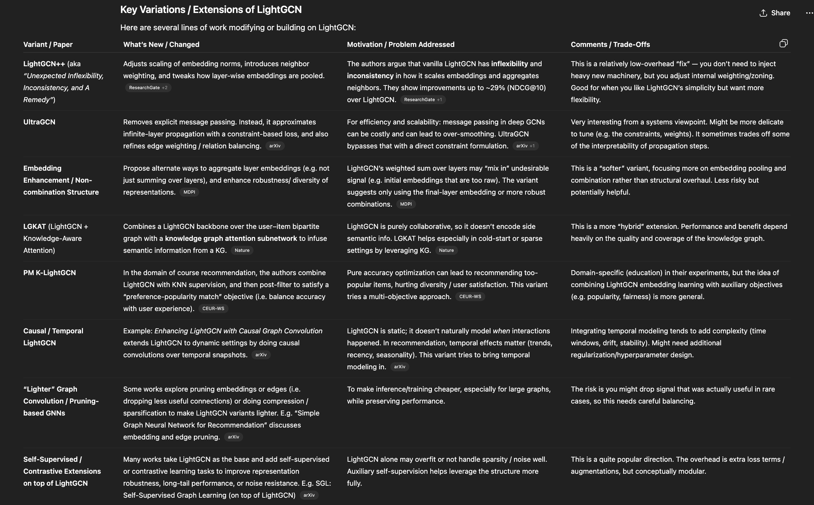

# Graph Learning for Recommendation
### NumPy implementations · GCN · LightGCN

Small, readable prototypes for understanding graph convolution and user-item recommendation. The repository focuses on the mechanics of neighborhood aggregation, embedding propagation, and ranking loss.

## Start here

| File | What it demonstrates | Current scope |
| --- | --- | --- |
| [gcn.py](gcn.py) | Normalized adjacency, a two-layer GCN, softmax, and manual backpropagation | Five-node synthetic classification example |
| [light_gcn.py](light_gcn.py) | User-item graph propagation, layer averaging, and BPR loss | Two users / four items; no embedding-optimization loop |
| [gcn_recommendation.py](gcn_recommendation.py) | Loading Amazon-Book user/item mappings and interactions | Data-loading prototype |

## Model flow

```text
Graph edges -> normalized adjacency -> neighborhood propagation
            -> node / user-item embeddings -> classification or ranking loss
```

These examples make the mathematical operations inspectable before scaling to a full recommender.

## Run the toy examples

```bash
git clone https://github.com/VioletGo319/GCN_Recommendation.git
cd GCN_Recommendation
python -m venv .venv
source .venv/bin/activate
pip install -r requirements.txt
python gcn.py
python light_gcn.py
```

The data-loading script additionally needs network access to the external LightGCN data files.

## Current status

This is an **exploratory implementation repository**, not a completed recommendation benchmark or the reproduction package for a published paper. No held-out Recall@K/NDCG@K result is reported.

The GCN script includes an initial diagnostic loss based on hard predictions; its later training loop computes cross-entropy from class probabilities. The LightGCN example computes propagation and BPR loss but does not train the embeddings. Random initialization is not consistently seeded across all examples.

## Next experiments

- Add deterministic runs and separate training/evaluation entry points.
- Implement negative sampling and embedding optimization.
- Establish fixed user-item splits and held-out ranking metrics.
- Compare initialization and pooling choices with controlled ablations.

## Background reading

- [LightGCN implementation and data](https://github.com/kuandeng/LightGCN)
- [LightGCN++ (RecSys 2024)](http://dmlab.kaist.ac.kr/~kijungs/papers/lightgcnppRecSys2024.pdf)


